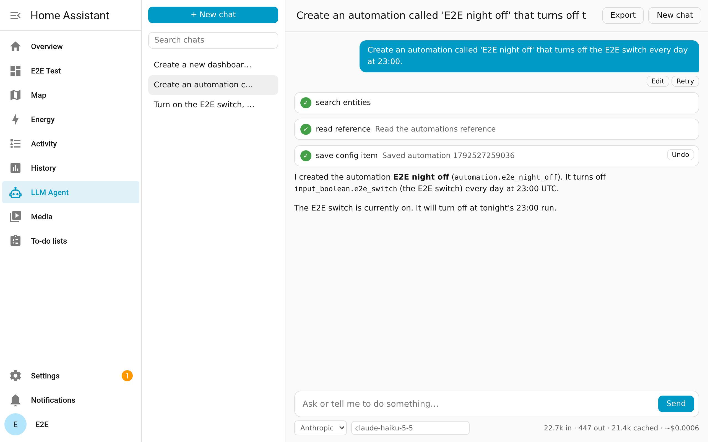
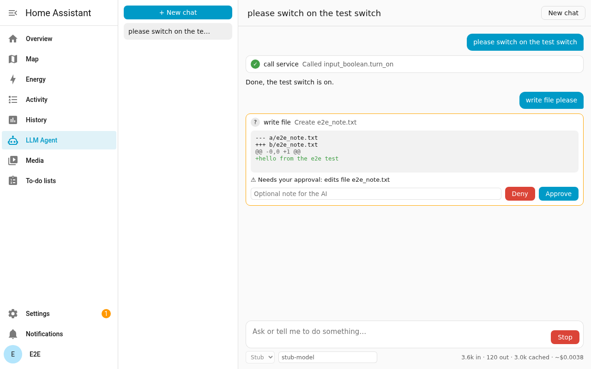
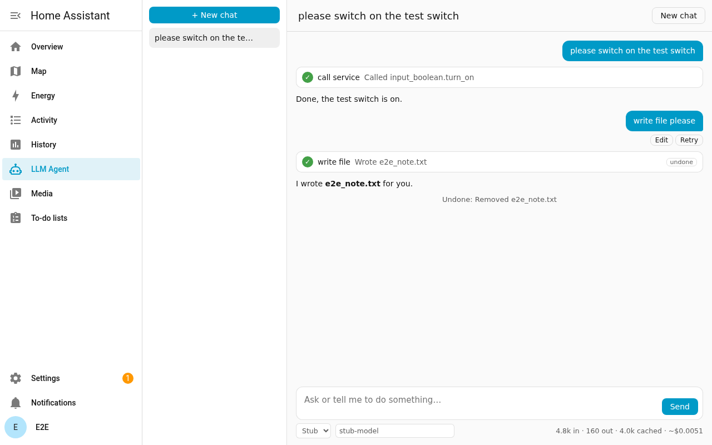
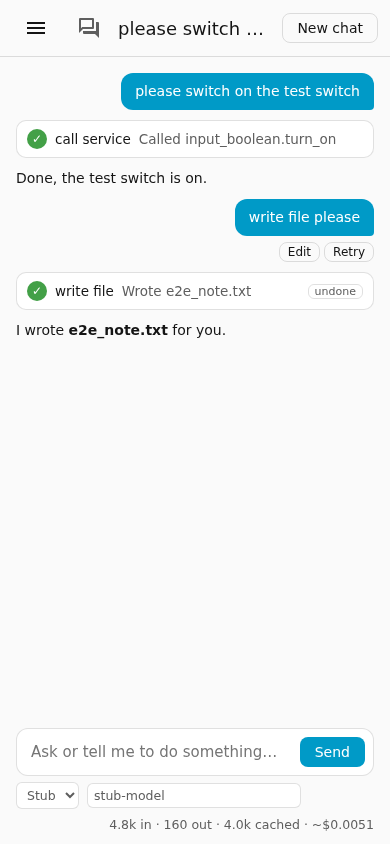
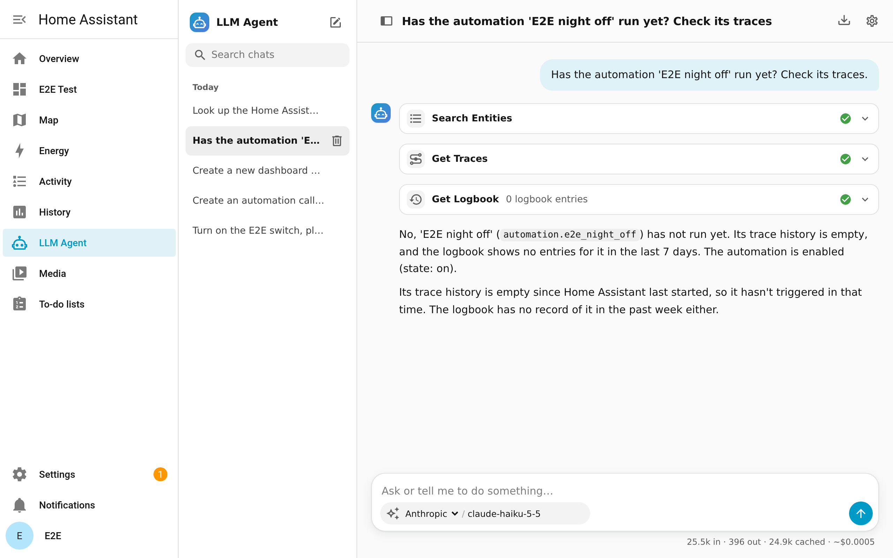
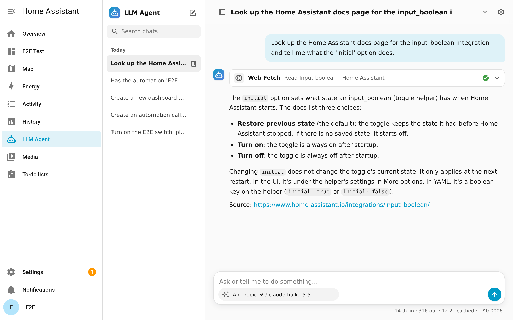
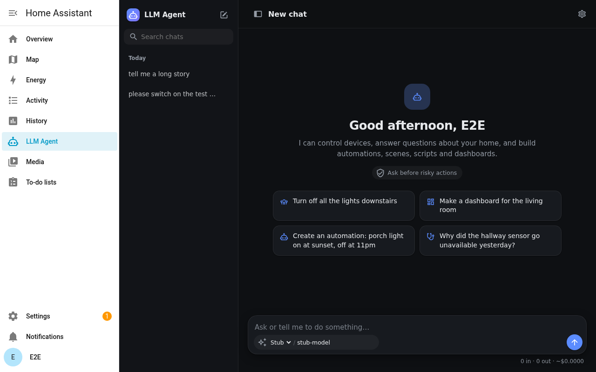

# LLM Agent for Home Assistant

[](https://github.com/nuedynamics/ha-llm-agent/actions/workflows/ci.yml)
[](https://github.com/nuedynamics/ha-llm-agent/releases)
[](https://hacs.xyz/docs/faq/custom_repositories/)
[](LICENSE)

A chat panel in your Home Assistant sidebar where an AI model does the work for you. It
switches devices, answers questions about your home, and builds automations, scripts,
scenes, dashboards and helpers. Bring your own model: Anthropic, OpenAI, OpenRouter, Google Gemini, your ChatGPT
subscription (experimental), or a free local model on Ollama.



> **Read [DISCLAIMER.md](DISCLAIMER.md) first.** The AI acts with administrator rights. It can
> make mistakes, and provider charges are yours. Risky actions ask for your approval by
> default, and every file or dashboard change can be undone.

**Contents:** [Install](#install) · [What it can do](#what-it-can-do) ·
[Safety](#safety-and-approvals) · [Providers](#providers-and-cost) ·
[Limitations](#limitations) · [Privacy](#privacy-and-storage) ·
[Troubleshooting](#troubleshooting) · [Testing](#how-it-is-tested) · [Roadmap](#roadmap)

## Install

Requires Home Assistant **2026.10** or newer and an administrator account.

### Recommended: HACS, one click

If you have [HACS](https://hacs.xyz), click this button. It opens HACS on your own Home
Assistant with this repository filled in:

[](https://my.home-assistant.io/redirect/hacs_repository/?owner=nuedynamics&repository=ha-llm-agent&category=integration)

1. Click **Download**, then restart Home Assistant.
2. Add the integration with this button, or from **Settings → Devices & services → Add
   integration → LLM Agent**:

   [](https://my.home-assistant.io/redirect/config_flow_start/?domain=llm_agent)

   If this button says *"This integration does not support configuration via the UI"*,
   Home Assistant hasn't loaded LLM Agent yet: download it in HACS first, then restart
   Home Assistant (Settings → System → ⋮ → Restart Home Assistant) and try again.

3. Accept the risk notice, choose a provider, and enter your API key and default model.
4. Open **LLM Agent** in the sidebar.

HACS tells you when an update is available.

### HACS, by hand

Use this if the button doesn't reach your Home Assistant.

1. HACS → ⋮ menu → **Custom repositories**.
2. Add `https://github.com/nuedynamics/ha-llm-agent` with type **Integration**.
3. Find **LLM Agent**, click **Download**, and restart Home Assistant.
4. **Settings → Devices & services → Add integration → LLM Agent**.

### Manual, without HACS

1. Download `llm_agent.zip` from the [latest release](https://github.com/nuedynamics/ha-llm-agent/releases/latest).
2. Unzip it into `/config/custom_components/llm_agent/` (that folder should then contain
   `manifest.json`).
3. Restart Home Assistant and add the integration as above.

To update, repeat these steps. There is no build step; the panel ships pre-built.

> HACS treats LLM Agent as a custom repository because it isn't in the default HACS store
> yet. A default store listing is planned for 1.0 (see the [roadmap](docs/ROADMAP.md)).

## What it can do

| Ask for | What happens |
| --- | --- |
| "Turn off everything downstairs", "set the thermostat to 20" | Calls the right services on the right entities. |
| "When did the back door last open?" | Reads states and history, then answers. |
| "How much energy did the dryer use each day last month?" | Reads long-term statistics (daily or hourly mean, min, max and change), which HA keeps for years. |
| "Turn the porch light on at sunset and off at 23:00" | Writes an automation into `automations.yaml`, validates it and reloads. You can open it in the HA editor afterwards. |
| "Make a script for the bedtime routine" | Scripts and scenes, handled the same way as automations. |
| "Make a dashboard for the living room" | Creates or edits a dashboard. |
| "Put the new Zigbee sensors in the right rooms" | Renames areas, devices and entities, and enables or disables them. |
| "Set up the Met.no weather integration" | Starts and answers config flows, reloads or removes integrations, and installs from HACS. |
| "Add `logger:` to configuration.yaml and restart" | Reads and edits YAML, checks the configuration, then reloads or restarts. |
| "Why didn't the porch light turn on last night?" | Reads the automation's traces, the logbook and the log, explains what happened and proposes a fix. |
| "How do I pair this Aqara sensor with ZHA?" | Reads the Home Assistant docs, searches the HA forum and GitHub issues (free, no key), and cites the pages. |
| "Is the garage door open?" (with a camera) | Takes a camera snapshot and looks at it. Needs a model that can see images. |
| "What is this device?" (with a photo) | Attach or paste up to three photos; it looks at them. Needs a model that can see images. |
| "Undo that" | Puts the file or dashboard back the way it was. |

It also adds an **Assist conversation agent** for each provider, so you can use the same
model with voice and text Assist. Assist uses Home Assistant's own tools, so there it can
only control, and answer questions about, the entities you expose to Assist.

### From automations and scripts

The `llm_agent.ask` action sends a prompt and returns the reply, so an automation can use
it:

```yaml
- action: llm_agent.ask
  data:
    prompt: "Summarise which doors and windows are open, in one sentence."
  response_variable: answer
- action: notify.mobile_app_phone
  data:
    message: "{{ answer.response }}"
```

Optional fields are `provider` (id or name), `model`, `title` (the chat's name in the
panel) and `conversation_id` (to continue a chat; the reply returns one). Nobody is there
to approve anything, so any action that would need approval is refused and the AI says
what it would have done. Everyday actions follow your approval mode as usual. These chats
show up in the panel too, marked with a robot icon.

**Scheduled prompts:** put the action in an automation with a time trigger ("every
Sunday at 6 pm, list unavailable devices and low batteries"). You can also ask the AI in
the panel to set one up; it writes the automation and you approve it.

In the panel:

- Replies stream as they are written. Each tool call shows as a card you can expand.
- File edits and deletions show a diff and wait for approval. Changes to files,
  automations and dashboards get an **Undo** button.
- Type `@` to pick an entity, area or device; the exact id goes into your message, so the
  AI doesn't have to search for it.
- You can **Edit** or **Retry** your last message, and **Copy** any code block.
- Conversations are saved and searchable, and you can **Export** one as Markdown.
- If a reply stops early (cut off, tool limit, you pressed Stop), it says why and offers
  **Continue**.
- Each chat shows its token use and an estimated cost. An optional daily spend cap stops
  and asks once the day's estimate passes it.
- It works on phones and in the companion app.

| Approval with a diff | Undo | Phone |
| --- | --- | --- |
|  |  |  |

| Why didn't it run? | Reading the docs |
| --- | --- |
|  |  |



## Safety and approvals

All settings are under **Settings → Devices & services → LLM Agent → Configure → Settings**.

| Setting | Default | What it does |
| --- | --- | --- |
| Approval mode | Ask before risky actions | `Ask before every change`, `Ask before risky actions`, `Reviewer` (a second AI model decides risky actions), or `Autopilot` (never asks). |
| Back up before risky actions | On | Takes a full HA backup before HACS installs and integration removal. |
| Protect sensitive data | On | Blocks reading `secrets.yaml`, auth and credential storage, databases, and files outside `/config`. Also blocks commands that issue tokens. |
| Refuse restart when configuration is invalid | On | Restarts only after a passing config check. |
| Allow shell commands | **Off** | Lets the AI run commands in the HA container. Asks you to confirm when you turn it on. |
| Use tools from MCP servers | **Off** | Offers the tools of servers added with HA's own [Model Context Protocol](https://www.home-assistant.io/integrations/mcp/) integration. See below. |
| Tool calls per message | 25 | Stops runaway loops. |

Risky actions include:

- unlocking locks, and opening garage doors and gates;
- disarming alarms;
- editing files and deleting things;
- installing or removing integrations;
- restarting.

In the default mode, everyday changes such as switching lights or saving an automation run
straight away, and you can undo the automation.

**Reviewer mode.** A second model, which can be a cheap one or a local Ollama model,
approves or denies each risky action in your place.
- It sees your request and the action with its diff, but never tool output, so text
  hidden in device names or files can't talk it into anything.
- It approves, or denies with a reason that goes back to the AI. When it is unsure,
  errors or times out, you are asked as usual.
- Actions on the always-ask list come to you whatever it says, even everyday ones. By
  default that list is locks, entry covers (garage doors and gates), disarming alarms,
  removing integrations, shell commands, raw script runs and direct file edits (their
  diffs show existing file text), and you can edit it.
- Anything too large for it to see whole, including a long request, comes to you.
- Its verdict shows on the tool card and goes in the audit log. Its tokens and cost are
  shown separately and count towards the daily spend cap.

**MCP servers.** Add a server with HA's Model Context Protocol integration (it handles
the address and sign-in), then turn on **Use tools from MCP servers**. Its tools show up
as `mcp_<server>_<tool>`. Those servers are outside your home: their tools can do
anything, and their own descriptions of those tools reach the AI. So while this is on,
every chat counts as having read outside content, like a web page, and every change asks
you first, in every approval mode. The approval card shows exactly what is sent.
Automations (`llm_agent.ask`) don't get MCP tools, because nobody is there to approve.

**Home notes.** The notebook button in the panel's header holds short facts and rules
that every chat sees ("the office is upstairs", "never turn off the freezer plug"). You
can edit them there, and the AI can propose changes. Those always ask you, in every
approval mode (the reviewer can't approve them), and can be undone.

**Web content.** Pages and search results can contain text written to steer an AI. Once a
chat has read anything from the web, every change in that chat asks you first, whatever
the approval mode, including Reviewer and Autopilot. Fetching addresses on your own network is blocked
unless you allow it, and that check also covers public names that point at your LAN.

**Approval rules.** Under **Approval rules**, one rule per line decides calls in every
approval mode: `allow light.*` (never ask for lights), `ask lock.*` (always ask for
locks), `deny cover.garage_door` (never do it). Patterns match a `domain.service`, an
entity id or a tool name, and `*` matches anything. Deny wins over ask, and ask over
allow. An allow only counts when it covers everything the call touches, so `allow
light.*` never lets through a call that also reaches a lock. Rules never switch off the
asking that web content, MCP tools or home notes turn on, and never let a member's risky
action skip the admin. An `ask` rule also asks before reads (`ask home_history`). If
what a call reaches changes while it waits for approval (a device joins the targeted
area), it isn't run. Start a line with `members` to apply it only to household members'
chats (`members deny lock.*`); in their chats, an entity a deny rule names is also hidden
from their device list and history.

**Household members.** Turn on **Let household members chat** (under **Household and
phone**) and users who aren't admins get the AI panel too:
- they see only their own chats (each admin also sees only their own, plus chats from
  automations and from before 0.4);
- they can see and control only the devices exposed to Assist (Settings → Voice
  assistants → Expose), by entity id, the same set a voice assistant gets, and only with
  everyday controls (on and off, brightness, temperature, media, covers, locks, alarms,
  scenes and scripts by name);
- no settings, files, automations, dashboards, notes, undo or model choice;
- Autopilot and Reviewer don't apply to them: everyday changes ask them as in the default
  mode, and risky ones (locks, alarms, garage doors) need an admin's approval on the
  phone. Without a phone set up, those are refused;
- a daily spend limit per member (US$0.50 by default), which they can't go past, and one
  reply at a time.

**Approve from your phone.** Set **Approve from this phone** to an admin's notify action
from the Home Assistant app (`notify.mobile_app_<phone>`). Approvals arrive as a
notification with Approve and Deny buttons:
- when nobody has the chat open, or after a minute unanswered in the panel;
- for automations (`llm_agent.ask`), which then wait up to 4 minutes for the phone
  instead of refusing;
- for household members' risky actions.

Each notification carries a random code, and a press only counts when it comes from an
admin's phone.

Settings, notes, undo and model lists are limited to administrator accounts. Every action
is written to an audit log.

## Providers and cost

| Provider | Base URL | Notes |
| --- | --- | --- |
| Anthropic | `https://api.anthropic.com` | Prompt caching cuts the cost of long chats. |
| OpenAI | `https://api.openai.com/v1` | Automatic prompt caching. |
| OpenRouter | `https://openrouter.ai/api/v1` | Takes any OpenRouter model id. |
| Google Gemini (unverified) | `https://generativelanguage.googleapis.com` | Native Gemini API. Written to Google's documentation but not yet tried against the live service; please report problems. Gemini also has a free tier. |
| ChatGPT subscription (experimental) | `https://chatgpt.com/backend-api/codex` | Uses your ChatGPT plan instead of an API key: you sign in with a code at auth.openai.com. It uses the same sign-in and endpoint as OpenAI's open-source Codex CLI, which OpenAI doesn't document for other apps, so it may break at any time. Not yet tried against a real account; please report how it goes. Usage counts against your plan's limits, and the panel shows no cost for it. |
| Ollama | `http://<host>:11434/v1` | Local and free. Needs a model with tool calling; see [Which model to use](#which-model-to-use). |

You can add several providers, switch between them per chat, or type any model id.

Rate limits and overloads are retried with backoff. Errors give the cause ("the API key was
rejected", "out of credit", "model not found") rather than a bare HTTP code.

### Which model to use

- **Building things** (automations, scripts, dashboards, helpers): use a capable hosted
  model. A small, cheap one such as Claude Haiku or GPT mini models is enough for most
  homes, and the larger ones handle complex requests better.
- **Local models on Ollama** are fine for switching devices and answering questions.
  Small ones (8B) usually can't build working automations: in our checks Llama 3.1 8B got
  simple control right and most building tasks wrong. The agent repairs common argument
  mistakes and ships a Home Assistant reference the model can read, but it can't make a
  weak model plan well.

Ollama's default context window is 4,096 tokens. To fit, models with a context window of
16,384 tokens or less (and Ollama providers with no context window set) get a smaller set
of tools: control, questions, history, automations, scripts, scenes and undo. For
everything else, set `OLLAMA_CONTEXT_LENGTH=32768` (or more) on the Ollama server if you
have the memory, and set the same number as the provider's **Context window**.

The cost shown is an estimate. Anthropic and OpenAI prices come from a built-in table,
checked against their published prices on 2026-10-20 (the date is also shown in the
settings). OpenRouter prices come live from OpenRouter. You can override prices per model
in the settings. Your provider's bill is the real number.

To limit spend, set **Daily spend cap** in **Configure → Settings**. Once the day's
estimated cost passes it, the agent stops before the next model call and the panel offers
**Continue anyway**. Models without a known price are not counted.

## Settings

**Settings → Devices & services → LLM Agent → Configure → Settings.** Every setting has a
default, a safe range and a one-line explanation. The less common groups start folded.

| Group | What you can change |
| --- | --- |
| Approvals | Approval mode and extra instructions for the AI |
| Safety | Backups before risky edits, protected files, blocking a restart with a broken config, shell commands, camera snapshots |
| Cost | Daily spend cap, steps per request, longest reply, price overrides |
| Context | When long chats are compacted (or never), recent turns kept whole, the home summary on or off |
| Chats and storage | Chats in memory, chats kept, auto-delete after N days, undo history size, count and age, audit log size |
| Connection | Request timeout and retries |
| Approval rules | Allow, ask or deny rules that apply in every approval mode |
| Household and phone | Household members' chat on or off, their daily limit, and the phone that approves |
| Reviewer mode | The reviewer's provider and model (the chat's own by default), and the always-ask list |
| Web research | Web pages on or off, fetching LAN addresses (off), web search: Free (HA forum, HA GitHub issues and Wikipedia, no key, the default), SearXNG (self-hosted, covers the whole web), Brave Search, or Off |
| Debugging | Log full prompts and replies (the log then contains your conversations) |

For a local model with a small context, set **Context window** when you add the provider
(Ollama uses 4,096 tokens unless you raise it). Compaction then starts early enough to keep
the chat working.

**Panel settings** (the gear at the top of the panel) are kept per browser: theme (follow
Home Assistant, light or dark), text size, compact layout, tool cards expanded, token use
and cost shown, and sending with Enter or Ctrl+Enter. Each admin can also make the current
model their own default for new chats there.

## Limitations

- **It can be wrong.** Small local models in particular can pick the wrong entity, or
  write an automation that doesn't do what you meant. Keep approvals on for anything that
  matters, and read the diff.
- **One approval phone.** Approvals by phone go to one notify action, not to each admin.
- **Undo covers files and dashboards only.** Device actions (on/off) and registry changes
  (renames, areas) can't be undone, so ask it to change them back. Integration removal and
  HACS installs are covered by the automatic backup instead.
- **Pictures need a vision model.** Camera snapshots and photos only work with models
  that can see images (Claude, GPT-4o and later, Gemini, or a vision model in Ollama).
  Pictures are sent with that turn only and are not kept in the chat.
- **Small local models can't build reliably.** See [Which model to use](#which-model-to-use).
  Ollama models also need tool calling; a model without it can chat but can't act.
- **Not in the default HACS store yet** (see [Install](#install)).

## Privacy and storage

Your messages, and whatever the AI looks up to answer them, go to the provider you chose.
When the AI reads a web page or searches, that request goes to the site or to the search
backend. Free search sends the query to community.home-assistant.io, api.github.com and
Wikipedia; turn search off under Web research if you'd rather it didn't. When the AI
looks at a camera or a photo you attach, the picture goes to the provider too (the panel
removes photo metadata such as location first); turn **Camera snapshots** off
under Safety if you'd rather it couldn't. Nothing goes anywhere else, and there is no
telemetry.

| Data | Where | Limit |
| --- | --- | --- |
| Conversations | `/config/.storage/llm_agent.*` | Loaded on demand; 5 kept in memory, 200 saved per person (both adjustable) |
| Undo snapshots | `/config/.llm_agent/snapshots/` | 50 MB and 50 snapshots, oldest removed first (adjustable) |
| Audit log | `/config/.llm_agent/audit.jsonl` | Rotated at 2 MB (adjustable) |

Delete a conversation from the list to remove it. **Configure → Storage and spend** shows
how much is stored and today's estimated spend, and can delete chats older than a number of
days or clear the undo history. **Configure → Settings → Chats and storage** can delete old
chats automatically.

Removing the integration leaves these files in place. If you want them gone, delete
`/config/.llm_agent/` and the `llm_agent.*` files in `/config/.storage/` by hand.

## Troubleshooting

**Error messages.** Provider errors show up in the chat with the cause and the HTTP status,
for example: `Anthropic: the API key was rejected (HTTP 401: ...)`.

**Debug logging.** Turn on **Enable debug logging** on the integration's page, or add this
to `configuration.yaml` and restart:

```yaml
logger:
  logs:
    custom_components.llm_agent: debug
```

With debug logging on, each model request logs its duration, stop reason, token counts and
cache hits, plus the outcome of every tool call.

**Diagnostics.** Go to Settings → Devices & services → LLM Agent → ⋮ → **Download
diagnostics**.

- It includes your settings and the last 20 actions, by tool name and outcome only.
- It leaves out API keys, credentials in URLs, your custom prompt, and all conversation
  text.

**Reporting a bug.** [Open an issue](https://github.com/nuedynamics/ha-llm-agent/issues/new/choose)
and attach the diagnostics file.

## How it is tested

Every push runs these checks on GitHub-hosted CI:

| Check | What it covers |
| --- | --- |
| Unit tests (244, **86% line coverage**) | The agent loop, approvals, and every tool against a real in-process Home Assistant. Also providers (streaming, retries, errors), storage, undo races, diagnostics redaction, and the Assist agent. Every example in the built-in HA reference is validated against Home Assistant's own schemas. Each CI run's summary has per-file coverage. |
| End-to-end browser test | A real Home Assistant container with a stub model and headless Chromium. It covers device control, approval with a diff, undo, reload and history, the phone layout, edit and retry, and photo upload. |
| hassfest and HACS validation | Home Assistant's and HACS's own checks for integrations. |
| Panel build check | Confirms the committed panel bundle matches the source. |
| CodeQL | Static security analysis of the Python and TypeScript code. |

Before each release, a **real-model check** (`LIVE_PROVIDER=anthropic LIVE_MODEL=<haiku model id> e2e/run.sh`) runs
against Claude Haiku. It:

1. turns a switch on;
2. asks about the switch's state;
3. creates an automation;
4. creates a dashboard;
5. reads the new automation's traces;
6. looks up an integration's docs page on home-assistant.io;
7. searches the web with free search and cites links;
8. looks at a camera showing a test picture and says what is in it, then does the same
   for an uploaded photo;
9. in reviewer mode, deletes the dashboard with the reviewer's approval and no card for
   you, and checks the reviewer's cost is counted.

After each step it checks that the change really happened in Home Assistant, or that the
right tool was used and the answer is grounded.

## Development

```sh
pip install -r requirements-test.txt
pytest --cov=custom_components/llm_agent && ruff check .
cd frontend && npm ci && npm run build   # rebuilds custom_components/llm_agent/www/
e2e/run.sh                                # real HA container + stub model + Chromium
```

[docs/ARCHITECTURE.md](docs/ARCHITECTURE.md) explains how the pieces fit together.

## Roadmap

The full plan is in [docs/ROADMAP.md](docs/ROADMAP.md). In short:

- **0.2.0 (released), debugging the home:** automation traces, the logbook, a log reader,
  a better template tester, and web research.
- **0.2.1 (released):** reviewer mode, where a second model approves or denies risky
  actions, and free web search with no key.
- **0.2.2 (released):** camera snapshots and photo upload.
- **0.2.3 (released):** the `llm_agent.ask` action for automations, long-term statistics,
  Google Gemini (unverified) and a lean tool set for small local models.
- **0.2.4 (released):** use a ChatGPT subscription instead of an API key (experimental).
- **0.2.5 (released):** blueprints, packages, template sensors and helpers, and a dashboard preview.
- **0.2.6 (released):** the panel reopens your last chat.
- **0.3.0 (released):** home notes (memory), scheduled prompts, and MCP servers as extra tools.
- **0.4.0 (released):** household members' chat, per-user history and spend limits,
  approval rules, and approving from your phone.
- **1.0:** a default HACS store listing, translations and accessibility, and a docs site.
- **Backlog:** more languages (panel, replies, right-to-left), accessibility (keyboard,
  screen readers, contrast, reduced motion, voice), and web research extras.

## License

Apache License 2.0. See [LICENSE](LICENSE) and [NOTICE](NOTICE).
